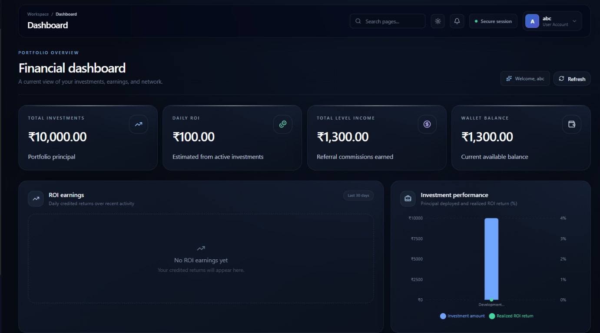
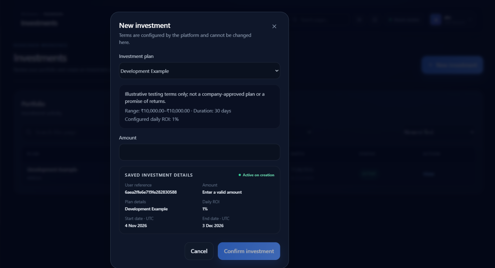
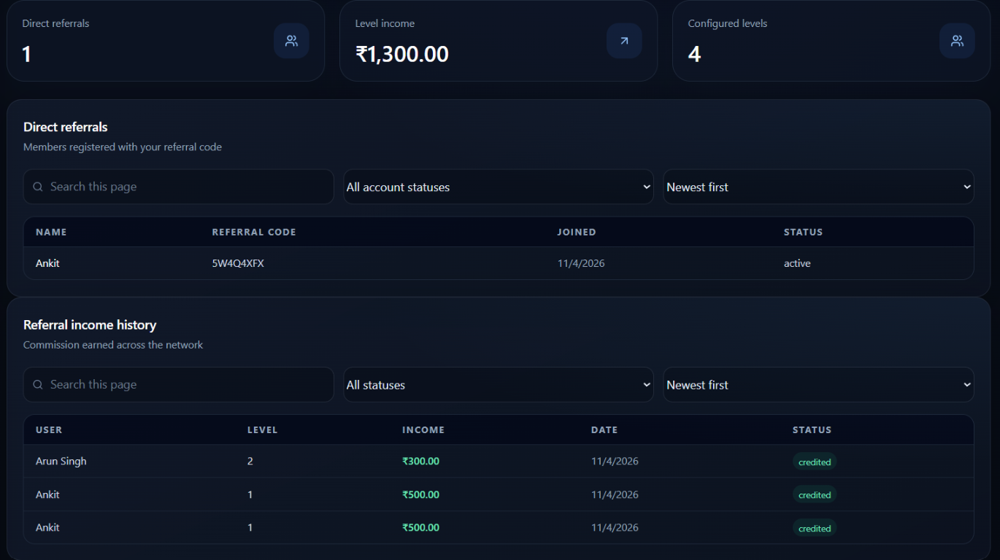
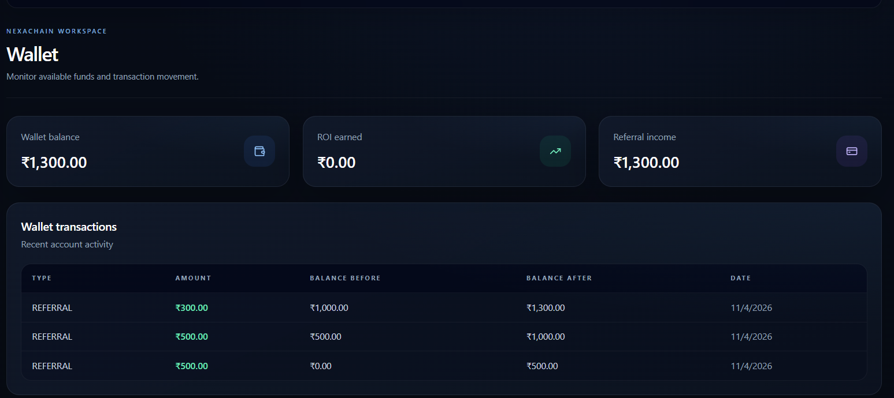
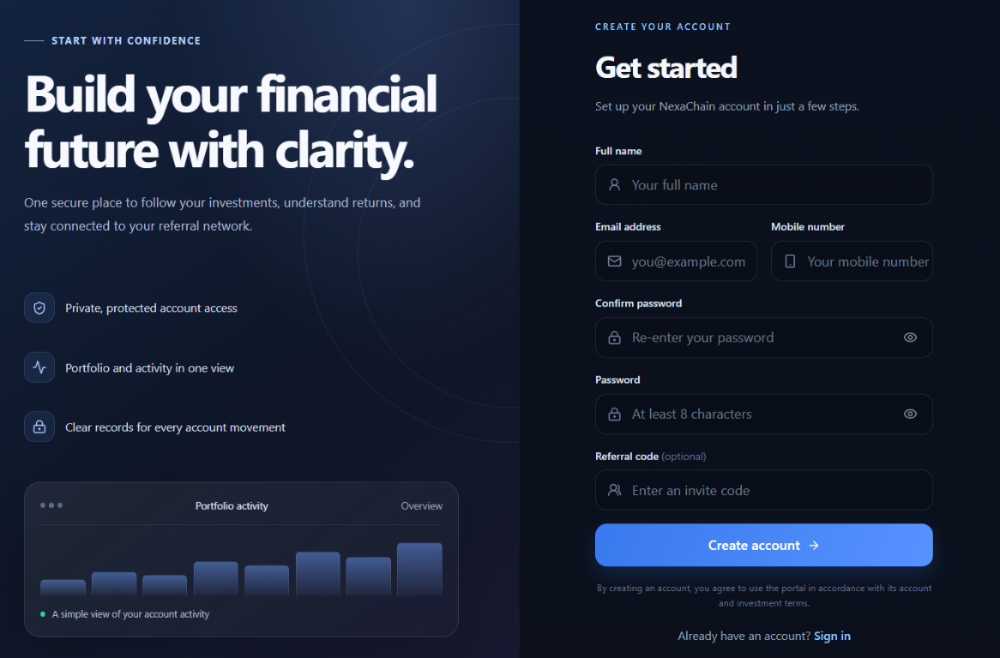

# NexaChain AI — Investment & Referral Management Platform

A full-stack MERN application built for the NexaChain AI MERN Stack Developer Technical Assessment. The project includes authenticated investment and referral workflows, a React dashboard, wallet and earnings ledgers, and scheduled, idempotent ROI processing.

> **Assessment / demo project:** This repository implements software workflows for evaluation and local testing. Example rates, plans, balances, and screenshots are illustrative only; they are not approved investment terms, financial advice, or a promise of returns. Do not use this project to accept real funds or offer financial products without the required legal, compliance, security, and operational reviews.

## Contents

- [Overview](#overview)
- [Technology](#technology)
- [Features](#features)
- [Repository layout](#repository-layout)
- [Setup](#setup)
- [Environment variables](#environment-variables)
- [Data model](#data-model)
- [API documentation](#api-documentation)
- [Financial workflows](#financial-workflows)
- [Scheduler and idempotency](#scheduler-and-idempotency)
- [Assumptions and limitations](#assumptions-and-limitations)
- [Testing](#testing)
- [Screenshots](#screenshots)

## Overview

The application separates the React client and Express API:

1. A user registers with an email, mobile number, password, and optional referral code.
2. The API hashes the password and issues a JWT for authenticated requests.
3. An authenticated user can view configured plans and create an investment.
4. The backend records eligible referral income, processes daily ROI, and writes corresponding wallet and history records.
5. The dashboard reads account totals and paginated histories from the API.

Financial mutations run in MongoDB transactions. The database must support transactions (a replica set or sharded cluster); a standalone MongoDB instance is not sufficient for these writes.

## Technology

| Area | Technologies |
|---|---|
| Client | React, Vite, Tailwind CSS, Axios, Recharts, Framer Motion, Lucide React |
| API | Node.js, Express, Mongoose |
| Data and authentication | MongoDB, JWT, bcryptjs |
| Scheduled processing | node-cron |
| Validation and security | express-validator, Helmet, express-rate-limit, MongoDB operator-key rejection |

## Features

- Registration, login, JWT-protected routes, and account profile.
- Investment plan listing, investment creation, paginated investment history.
- Dashboard summary, earnings analytics, and charts backed by API data.
- ROI history and wallet transaction ledger.
- Direct referrals, nested referral tree, and referral-income history.
- Configurable referral levels and eligibility threshold.
- Daily ROI processing from both the scheduler and an admin-only manual endpoint.
- Idempotency safeguards to prevent duplicate ROI/referral credits.
- Search, filtering, sorting, pagination, and loading/error/empty states where supported by the API and UI.

## Repository layout

```text
client/                         React/Vite application
  src/pages/                    Application pages, including the dashboard
  src/components/dashboard/     Dashboard-specific UI
  .env.example                  Client environment template
server/                         Canonical Express/Mongoose backend
  src/config/                   Database, plan, referral, security, and cron config
  src/controllers/              HTTP request handlers
  src/middleware/               Authentication and request validation
  src/models/                   Mongoose schemas and indexes
  src/routes/                   REST route definitions
  src/services/businessLogic.js ROI/referral business workflows
  API_DOCUMENTATION.md          Detailed endpoint documentation
  postman_collection.json       Importable Postman collection
docs/
  END_TO_END_CHECKLIST.md       Workflow verification checklist
  screenshots/                 Supplied application screenshots
```

`server/` and `client/` are the source applications. If `backend/` or `frontend/` compatibility launchers are present in a checkout, they are not separate implementations of the API or UI. The scheduler is registered from `server/src/config/cron.js`; there is no separate canonical `jobs/` implementation.

## Setup

### Prerequisites

- Node.js and npm versions compatible with the package manifests.
- MongoDB running as a replica set or a MongoDB-compatible managed cluster that supports transactions.

### 1. Configure and start the backend

From the repository root:

```powershell
cd server
npm install
Copy-Item .env.example .env
```

Edit `server/.env` with a transaction-capable MongoDB URI and a newly generated JWT secret. Then start the API:

```powershell
npm run dev
```

The default API base URL is `http://localhost:5000/api`.

### 2. Configure and start the frontend

In a second terminal, from the repository root:

```powershell
cd client
npm install
Copy-Item .env.example .env
npm run dev
```

Vite prints the local frontend URL (normally `http://localhost:5173`). Set the backend `CLIENT_URL` to that exact origin. Do not commit `.env` files or real credentials.

## Environment variables

### Backend (`server/.env`)

| Variable | Required | Purpose |
|---|---:|---|
| `PORT` | No | API port; defaults to `5000`. |
| `MONGODB_URI` | Yes | MongoDB connection string. Use a replica set or sharded cluster for transactions. |
| `JWT_SECRET` | Yes | Secret used to sign JWTs; use a random value of at least 32 characters and never publish it. |
| `CLIENT_URL` | No | Trusted frontend origin for CORS; local default is `http://localhost:5173`. |
| `CRON_TIMEZONE` | No | Timezone used by node-cron. The scheduler falls back to `TZ`, then UTC. |
| `TZ` | No | Process timezone and scheduler fallback; `.env.example` sets `UTC`. |
| `ADMIN_EMAIL` | No | Email used for the configured initial admin account, when enabled. |
| `ADMIN_PASSWORD` | No | Password used with `ADMIN_EMAIL`; supply a secure value if enabling admin setup. |
| `REFERRAL_MAX_LEVELS` | Production: yes | Maximum referral depth. Configure together with explicit referral levels. |
| `REFERRAL_LEVELS` | Production: yes | JSON array of `{ "level": number, "percentage": number }` commission rules. |
| `MIN_ELIGIBLE_INVESTMENT_AMOUNT` | No | Minimum investment amount that qualifies for referral payouts; the example is `0`. |
| `INVESTMENT_PLANS` | Production: yes | JSON plan configuration used by the API. Empty configuration uses a clearly illustrative local-development example only. |
| `TEST_MONGODB_URI` | Tests only | Optional test-cluster URI; tests use a uniquely named disposable database. |

See [`server/.env.example`](./server/.env.example) for the variable names and example formats. The percentage values there are development examples, not assessment-specified or approved business terms.

### Frontend (`client/.env`)

| Variable | Required | Purpose |
|---|---:|---|
| `VITE_API_URL` | No | API base URL, including `/api`; defaults to `http://localhost:5000/api`. |

See [`client/.env.example`](./client/.env.example).

## Data model

| Model | Main data | Relationships and safeguards |
|---|---|---|
| `User` | Name, email, mobile, password hash, referral code, wallet balance, earned totals, account status, role | Unique email/referral code; optional parent user through `referredBy`; password is bcrypt-hashed. |
| `Investment` | Owner, amount, plan details, start/end dates, daily ROI rate, status, generated ROI | References its user; status is `active`, `completed`, or `cancelled`; indexed for owner/status and active/end-date queries. |
| `ReferralIncome` | Receiver, income-generating user, level, amount, date, status, investment reference | User and investment references; unique idempotency and compound indexes protect payout records. |
| `ROIHistory` | User, investment, ROI amount, date, status | References its user and investment; unique daily investment key prevents repeated ROI history for the same eligible day. |
| `WalletTransaction` | User, transaction type, amount, before/after balance, reference, description, status | Ledger references ROI or referral records and supports transaction history queries. |
| `CronLock` | Scheduler lock identity and lease data | Coordinates concurrent scheduled/manual ROI processing. |

Schema definitions are in [`server/src/models/`](./server/src/models/). The implementation includes compatibility aliases for some legacy field names; the fields above describe the logical records rather than every stored alias.

## API documentation

All endpoints are rooted at `http://localhost:5000/api`. For private routes, send the JWT returned by registration or login in the `Authorization` header using the Bearer scheme. Responses use JSON and a common success envelope; validation and authentication errors return explicit error responses. Financial writes require MongoDB transaction support.

| Group | Endpoint | Purpose |
|---|---|---|
| Auth | `POST /auth/register`, `POST /auth/login` | Create account or obtain a JWT. |
| Auth | `GET /auth/me`, `POST /auth/logout` | Get current profile or acknowledge client-side logout. |
| Investments | `GET /investments/plans`, `POST /investments` | Read configured plans and create an investment. |
| Investments | `GET /investments`, `GET /investments/:id` | List or inspect the authenticated user's investments. |
| Dashboard | `GET /dashboard/summary`, `GET /dashboard/earnings` | Fetch account totals and earnings analytics. |
| Dashboard | `GET /dashboard/roi-chart`, `GET /dashboard/earnings-trend` | Fetch chart series. |
| ROI | `GET /roi/history` | Read paginated ROI history. |
| Referrals | `GET /referrals/direct`, `GET /referrals/tree` | Fetch direct referrals or nested hierarchy. |
| Referrals | `GET /referrals/income`, `GET /referrals/summary` | Read referral payouts and summary. |
| Wallet | `GET /wallet`, `GET /wallet/transactions` | Read wallet totals and paginated transaction ledger. |
| Admin | `GET /admin/users`, `GET /admin/investments` | Admin-only user and investment listing. |
| Admin | `POST /admin/roi/run` | Admin-only manual ROI run; repeated same-day runs are idempotent. |

### Example requests

Register a user (an empty referral code creates an un-referred account):

```http
POST /api/auth/register
Content-Type: application/json
```

```json
{
  "fullName": "Jane Doe",
  "email": "jane@example.com",
  "mobileNumber": "9876543210",
  "password": "replace-with-a-strong-password",
  "referralCode": ""
}
```

Create an investment using a configured plan. Plan rates and dates are server-controlled:

```http
POST /api/investments
Content-Type: application/json
```

Include the authenticated user's JWT bearer header with this private request.

```json
{ "planId": "demo", "amount": 500 }
```

Example response envelope:

```json
{
  "success": true,
  "message": "Investment created successfully.",
  "data": {
    "investment": {
      "_id": "<investment-id>",
      "amount": 500,
      "planName": "Configured plan",
      "dailyROIPercentage": 0.05,
      "status": "active"
    }
  }
}
```

For complete field descriptions, pagination/filtering options, tree and dashboard response shapes, error cases, and admin endpoints, see [`server/API_DOCUMENTATION.md`](./server/API_DOCUMENTATION.md). Import [`server/postman_collection.json`](./server/postman_collection.json) into Postman for request examples.

## Financial workflows

### Daily ROI

- Active, eligible investments are processed against a UTC date boundary.
- The daily amount is derived from the investment principal and configured daily percentage, then rounded to two decimal places.
- The service records ROI history, updates the user's wallet and earned totals, and writes a wallet transaction within a MongoDB transaction.
- A unique daily investment idempotency key prevents a repeated run from crediting the same investment twice for the same eligible day.

### Referral income

- A referral code establishes the parent-child relation during registration.
- At investment creation, the service walks up the configured referral hierarchy and applies configured, eligible level percentages.
- Each payout, the receiver's balance/totals, and corresponding wallet transaction are persisted atomically.
- Unique payout keys/indexes prevent duplicate commissions for the same qualifying investment and level.

### Wallet consistency

Wallet changes and their corresponding financial-history records are committed together. If the transaction cannot complete, the financial mutation is not reported as successful. The wallet transaction ledger exposes balance-before and balance-after values for traceability.

## Scheduler and idempotency

The scheduler is implemented in [`server/src/config/cron.js`](./server/src/config/cron.js) and invokes the shared ROI business service. The intended processing timezone is **UTC**: set `CRON_TIMEZONE=UTC` to run the job daily at **12:00 AM UTC**, matching the UTC calendar-day boundaries used for ROI eligibility and duplicate prevention. The scheduler can be configured with another timezone (`CRON_TIMEZONE`, then `TZ`, then UTC), but that only changes when the job fires; ROI eligibility and idempotency remain based on the UTC date.

The ROI service uses both a database lock/lease to coordinate overlapping runs and per-investment/per-day idempotency to protect against retries or duplicate execution. Admins can also trigger a manual run through `POST /api/admin/roi/run`; it uses the same safeguards.

## Assumptions and limitations

The assessment does not define financial terms or payment behavior. These implementation choices are explicit and should be reviewed before any non-demo use:

1. **Plans and ROI rates:** Production plan IDs, amounts, durations, and rates must be supplied through `INVESTMENT_PLANS`. The built-in empty-config fallback is only for local development and is illustrative, not approved or promised.
2. **Referral commissions:** Production referral depth and percentages must be explicitly configured with `REFERRAL_MAX_LEVELS` and `REFERRAL_LEVELS`. Example percentages in `.env.example` are not assessment requirements.
3. **Referral payout event:** Eligible referral payouts are initiated when an investment is created; the configured minimum eligible amount and level rules determine recipients.
4. **No deposits or payment processor:** Creating an investment stores the investment record but does **not** debit the wallet. The assessment does not specify funding, withdrawals, or a payment integration.
5. **Date handling:** The intended schedule is midnight UTC (`CRON_TIMEZONE=UTC`), and ROI eligibility/idempotency use UTC calendar-day boundaries. Choosing a different scheduler timezone changes the trigger time, not the ROI date boundary.
6. **Authentication:** JWTs are returned in JSON and stored by the browser client in `localStorage`; logout clears the client token. Server-side JWT revocation/refresh-token rotation is not implemented.
7. **Production readiness:** This is an assessment implementation. Real financial use requires independent security, compliance, accounting, operational, and load reviews, plus explicit approved product terms.

## Testing

Run backend tests:

```powershell
cd server
npm test
```

Run the frontend type-check and production build:

```powershell
cd client
npm run build
```

Backend integration tests use MongoDB and a uniquely named disposable test database. Set `TEST_MONGODB_URI` to a test cluster with permission to create and drop that database. Do not point tests at production data.

The end-to-end checklist is in [`docs/END_TO_END_CHECKLIST.md`](./docs/END_TO_END_CHECKLIST.md). Latest verification on **2026-11-05**: **25 backend tests passed (25/25)** and the **frontend TypeScript check and production build passed**.

## Screenshots

The following user-provided screenshots show the application UI. Any financial values visible in them are sample/demo values and should not be interpreted as live records or approved terms.

### Dashboard and earnings charts



### Investment creation form



### Referrals and referral income



### Wallet and transaction history



### Registration



These are the screenshots supplied for this README; they do not include separate login, investment-history-table, or nested-referral-tree captures.

## Assessment deliverables

- **Repository:** [Ankit24072002/investement_Platform](https://github.com/Ankit24072002/investement_Platform)
- **Database schemas:** [`server/src/models/`](./server/src/models/)
- **API source and documentation:** [`server/src/`](./server/src/) · [`server/API_DOCUMENTATION.md`](./server/API_DOCUMENTATION.md)
- **Business logic and scheduler:** [`server/src/services/businessLogic.js`](./server/src/services/businessLogic.js) · [`server/src/config/cron.js`](./server/src/config/cron.js)
- **React dashboard:** [`client/src/pages/DashboardPage.jsx`](./client/src/pages/DashboardPage.jsx)
- **Postman collection:** [`server/postman_collection.json`](./server/postman_collection.json)
- **Workflow checklist:** [`docs/END_TO_END_CHECKLIST.md`](./docs/END_TO_END_CHECKLIST.md)

---

Developed as a MERN Stack Developer Technical Assessment project for NexaChain AI.
